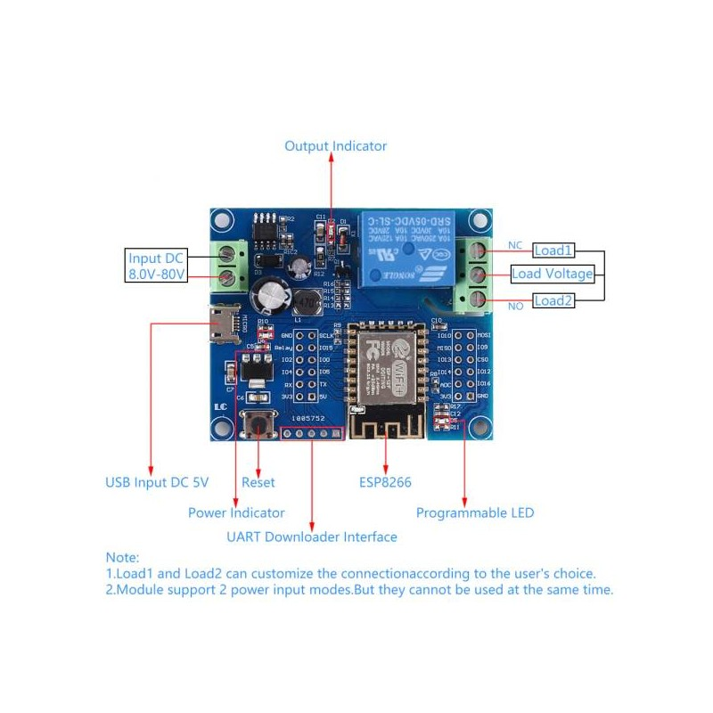
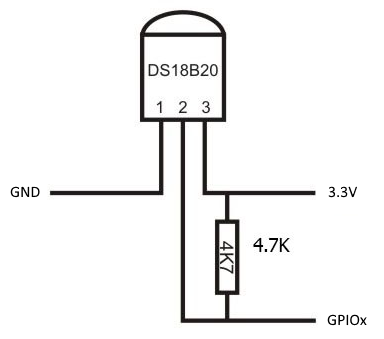

# Esp-thermostat
**WiFi thermostat based on ESP8266 and DS18B20 temperature sensor.**

The project comes from this [article](https://iotprojectsideas.com/temperature-control-with-esp8266-asyncwebserver/)
and adjusted for the ESP12-F board with embedded relay from Aliexpress.

### Installation
 - Connect the DS18B20 Dallas temperature sensor to the ESP12-F GPIO2.
 - Add a 4.7k ohm resistor to GPIO2 pin and 3.3V pin. 
 - VDD and GND pins are connected to the 3.3V supply and the ground of the ESP12-F module.

### Wiring

|  ESP-12F  |  RELAY  |  DS18B20  |
|-----------|---------|-----------|
|  GPIO04   |         |           |
|  GPIO05   |         |           |
|  GPIO00   |         |           |
|  GPIO02   |         |   DATA    |
|  GPIO14   |         |           |
|  GPIO12   |         |           |
|  GPIO13   |         |           |
|  GPIO16   |         |           |
|  GPIO15   |   PIN   |           |

### Photos

### Roadmap

 - Add mDNS support
 - Add MQTT support
 - Setup OTA firmware update process
 - Setup Github CI/CD
